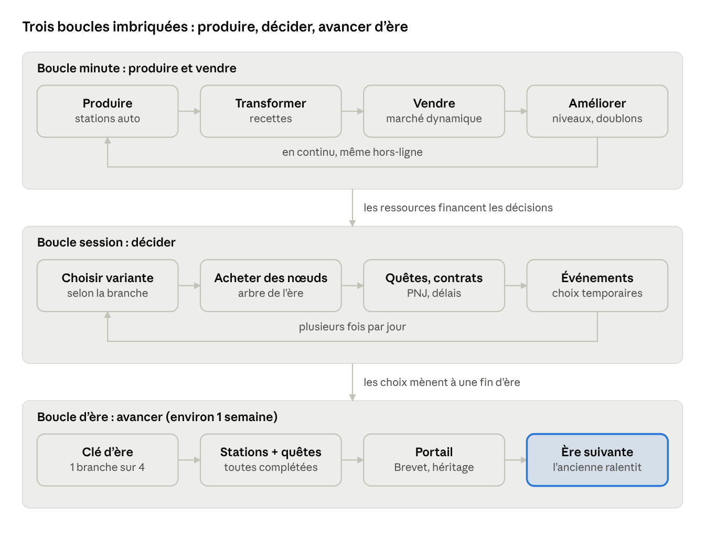

# Industrimental — Game Design Document

> Copie exportée du document vivant (Claude Docs) : https://claude.ai/artifact/F1vkuWbsfuwMhCVuMZG82a — la version de référence est le document en ligne.

Nov 6, 2026 · @Naomi

Industrimental est un jeu incremental mobile (portrait, F2P éthique) où le joueur fait avancer l'industrie humaine du troc jusqu'à l'ère spatiale, à travers 10 ères qui remplacent le prestige classique.

## 1. Vision et piliers

**Pitch :** « Du caillou échangé contre une peau jusqu'à la fusée réutilisable : bâtis l'industrie humaine, une ère à la fois, et choisis quelle civilisation tu deviens. »

Le joueur fait défiler une frise de gauche à droite. Chaque ère est un chapitre d'environ une semaine, avec ses propres stations, ressources, quêtes et son arbre d'upgrade. Terminer une ère remplace le prestige : on avance dans l'histoire au lieu de recommencer la même boucle.

### Piliers de design

1. **Avancer plutôt que recommencer.** Pas de reset répétitif. Chaque fin d'ère ouvre un décor, des mécaniques et des ressources neuves.
2. **Des choix qui se voient.** Les variantes de stations et les 4 fins d'ère changent la façon de jouer, pas seulement un multiplicateur.
3. **Un idle impliqué.** Rythme hybride : le joueur optimise ses recettes, négocie au marché et répond aux événements, et la production continue hors-ligne (plafonnée).
4. **Un diorama vivant.** Rendu 2.5D low-poly semi-réaliste, animé en calques, avec parallaxe et particules. Chaque achat se voit dans la scène.
5. **Rire de l'histoire.** Ton décalé, anachronismes assumés, PNJ satiriques. On apprend un peu, on sourit beaucoup.

### Public cible

- Joueurs d'incrementals et de jeux de gestion mobile (25–45 ans), qui jouent 3 à 6 sessions courtes par jour.
- Joueurs lassés des boucles de prestige infinies, qui cherchent une progression avec un début, un milieu et une fin.
- Jeu à une main, en portrait, en français et en anglais au lancement.

## 2. Décisions clés

Ces choix viennent du questionnaire du 6 novembre 2026 ; la colonne « Origine » distingue tes réponses des trous que j'ai comblés.

| Sujet | Décision | Origine |
| --- | --- | --- |
| Portée v1 | 10 ères, du troc à l'ère spatiale/robotique | Questionnaire |
| Extensions | Lune, Mars, autres systèmes, galaxies en mises à jour | Questionnaire |
| Rythme | Hybride actif/idle, hors-ligne plafonné (8 h, jusqu'à 24 h via l'arbre) | Questionnaire + plafond comblé |
| Durée d'une ère | Environ 1 semaine pour un joueur régulier (ère 1 plus courte : 1 à 2 jours d'onboarding) | Questionnaire + ajustement |
| Prestige | Aucun reset classique : les ères le remplacent | Brief |
| Transition d'ère | Mix : héritage ciblé et ères passées qui tournent au ralenti | Questionnaire |
| Placement | Panorama horizontal à emplacements fixes | Questionnaire |
| Production | Recettes de plus en plus complexes d'ère en ère | Questionnaire |
| Commerce | Marché dynamique (offre/demande), marchands PNJ, contrats | Questionnaire |
| Fins d'ère | 4 fins par ère + 1 fin hybride secrète à partir de l'ère 3 | Questionnaire + fin secrète comblée |
| Variantes de stations | 2 ou 3 variantes au déblocage, reconvertibles contre un coût | Questionnaire |
| Quêtes | Production, narratives/PNJ, contrats commerciaux | Questionnaire |
| Événements | Aléatoires, à choix, jamais bloquants | Questionnaire |
| Orientation | Portrait | Questionnaire |
| Rendu | Sprites 2D « low-poly » en calques, parallaxe, particules en code | Questionnaire |
| Stack | Go + Ebitengine, interface maison, passerelles natives iOS/Android | Questionnaire |
| Ton | Décalé / humoristique | Questionnaire |
| Langues | Français et anglais au lancement | Comblé |
| Monétisation | F2P éthique : pubs récompensées optionnelles, cosmétiques, aucune monnaie premium | Questionnaire + détail comblé |

## 3. Boucle de jeu



La boucle minute tourne seule et nourrit les décisions de la boucle session ; ces décisions mènent à l'une des 4 fins, qui ouvre l'ère suivante pendant que l'ancienne continue au ralenti.

## 4. Anatomie d'une ère

Une ère est un chapitre autonome : environ 10 stations, 6 à 8 ressources critiques, un arbre à 4 fins, environ 25 quêtes et un marché propre.

### Conditions de complétion

Une ère est terminée quand les trois conditions sont remplies :

1. **Une branche de l'arbre achevée** : le nœud final (« Clé d'ère ») d'une des 4 branches est acheté.
2. **Toutes les stations débloquées** : chaque station de l'ère existe au moins une fois, peu importe la variante choisie.
3. **Toutes les quêtes de l'ère remplies** : les quêtes principales sont communes à toutes les branches ; les quêtes optionnelles de branche ne comptent pas.

Le portail vers l'ère suivante apparaît à droite du panorama quand les trois jauges sont pleines. Le joueur choisit le moment du passage : il peut rester pour optimiser son héritage.

### Les stations et leurs variantes

- Une station occupe un emplacement fixe du panorama et produit ou transforme des ressources.
- À son déblocage, le joueur choisit **1 variante parmi 2 ou 3**. Exemple : l'Atelier de taille produit des pointes de chasse, des outils agricoles ou des parures d'échange.
- Chaque variante sert un ensemble de ressources critiques différent : on choisit selon la branche visée.
- **Reconversion** : changer de variante coûte 50 % du coût de déblocage et immobilise la station (chantier de 10 min au début de l'ère, jusqu'à 2 h vers la fin). L'arbre peut réduire ce coût.
- Une station a des niveaux (cadence, capacité) et, plus tard, des **modules** (1 à 3 emplacements) qui ajoutent des effets.
- Certaines stations peuvent être construites plusieurs fois sur les emplacements libres (des « doublons », au coût croissant).

### Les ressources critiques

- Chaque ère définit 6 à 8 ressources critiques, réparties en 4 familles alignées sur les 4 fins.
- Chaque fin exige surtout 3 ressources critiques ; deux fins voisines en partagent une. Le joueur ne peut donc pas tout maximiser.
- Les ressources de base (nourriture, matériaux, monnaie) sont communes et alimentent tout le reste.

### L'arbre d'upgrade à 4 fins

Chaque arbre a la même grammaire, déclinée différemment à chaque ère :

- **Tronc commun** (6 à 8 nœuds) : bases de l'ère, déblocage des premières stations.
- **4 branches**, une par axe de fin :
  - **Négoce** : marché, prix, contrats, marchands.
  - **Cadence** : volume de production, nombre de stations, rendement brut.
  - **Ingéniosité** : recettes avancées, automatisation, efficacité des transformations.
  - **Communauté** : main-d'œuvre, moral, événements, quêtes.
- Chaque branche compte 10 à 14 nœuds et **2 ou 3 chemins parallèles** vers la Clé d'ère. Exemple en Négoce : le chemin des Caravanes (volume, routes) ou celui des Foires (prix, événements). Chaque chemin consomme des ressources différentes.
- Des **ponts** relient les branches voisines : un nœud pont compte pour les deux branches, mais coûte plus cher.
- La **fin hybride secrète** (à partir de l'ère 3) se débloque en atteignant 75 % de deux branches voisines. Elle donne un Brevet unique et une séquence narrative bonus.
- Les nœuds se paient en ressources de l'ère. Il n'y a pas de « points de compétence » séparés : l'économie reste au centre.

### Ce que change une fin

La fin choisie fixe le **Brevet** gagné (voir section 5) et colore le début de l'ère suivante. Exemple : finir l'ère du Troc en Négoce fait arriver dans l'ère des Marchés avec un marchand PNJ supplémentaire et des prix de départ plus favorables.

## 5. Transition et héritage

Passer une ère donne un héritage ciblé (Brevet + Savoir-faire), et l'ère quittée continue de tourner au ralenti. Rien n'est jamais remis à zéro deux fois.

### Ce qui se passe au passage

| Élément | Sort |
| --- | --- |
| Ressources, stations, niveaux de l'ère | Restent dans l'ère, qui passe en régime de croisière |
| Brevet de la fin choisie | Gagné pour toujours ; effet permanent sur toutes les ères suivantes |
| Savoir-faire | Monnaie d'héritage, du type de la fin (Négoce, Cadence, Ingéniosité, Communauté) |
| Arbre de l'ère | Figé, consultable ; les branches non finies restent achetables en Archives |
| Quêtes de l'ère | Terminées ; les quêtes de branche non faites restent disponibles en Archives |

### Brevets

- Un Brevet par fin, soit 4 par ère (+ 1 secret à partir de l'ère 3).
- Effets **de gameplay**, pas seulement des pourcentages. Exemples : « Bouche-à-oreille » (les contrats affichent un client de plus), « Contremaître » (une station par ère produit pendant sa reconversion), « Brouillon de génie » (première recette avancée débloquée dès le début).
- Ils s'affichent sur la frise, sous forme de vitrine de trouvailles : c'est la collection longue durée du joueur.

### Savoir-faire

- Gagné à la fin d'une ère, en quantité liée à la performance (quêtes de branche faites, production totale, temps).
- Dépensé dans un petit **arbre d'Atelier** global (environ 30 nœuds) : confort de jeu, plafond hors-ligne, emplacements de modules, vitesse de reconversion.
- Les 4 types de Savoir-faire poussent le joueur à varier ses fins d'une ère à l'autre.

### Ères passées en régime de croisière

- Une ère terminée produit à 10 % de son rythme final, sans intervention.
- Elle exporte des **ressources d'époque** vers les ères suivantes via le **Comptoir temporel** (un bâtiment présent dans chaque ère). Exemple : la poterie de l'ère 2 sert de contenant dans certaines recettes de l'ère 4.
- Règle d'or : une ressource d'époque est **un bonus, jamais une condition**. Elle remplace un intrant ou accélère une recette, mais aucune progression n'en dépend.

### Archives : revenir sans recommencer

- Le joueur peut revisiter une ère passée pour finir une autre branche et gagner son Brevet.
- L'ère reprend là où il l'a laissée : pas de reset. Les nœuds restants gardent leur plein coût : compléter toutes les branches d'une ancienne ère est un gros avantage pour les ères suivantes, et le travail demandé doit être à la hauteur.
- Coût croissant : chaque Brevet obtenu dans une ère augmente le coût des autres branches de cette même ère (piste d'équilibrage : ×2,5 par Brevet déjà obtenu dans l'ère). Les Brevets des autres ères n'ont aucun effet. On ne peut donc pas tout avoir vite : l'ordre dans lequel on prend les Brevets devient une stratégie, et le temps idle sert à financer les plus chers.
- Collectionner les 40+ Brevets de la v1 devient l'objectif de fin de jeu, sans prestige.

## 6. Économie

L'économie repose sur trois couches : des ressources produites, des recettes qui les transforment et un marché dynamique qui en fixe la valeur. Chaque ère a sa propre économie, qui repart d'environ 10¹ et culmine vers 10¹².

### Ressources

| Catégorie | Rôle | Exemple (ère 1) |
| --- | --- | --- |
| Base | Produite sans intrant, alimente tout | Baies, silex, bois |
| Intermédiaire | Issue d'une recette, sert d'intrant | Outils taillés, peaux tannées |
| Critique | Exigée par l'arbre et les Clés d'ère | Parures, ocre, sel |
| Monnaie d'ère | Unité d'échange du marché (coquillages, drachmes, livres, crédits…) | Coquillages |
| D'époque | Importée d'une ère passée, bonus seulement | — |

### Recettes

- **Ères 1–2** : surtout de la production directe, avec 1 à 2 recettes à 1 intrant.
- **Ères 3–5** : recettes à 2 intrants et sous-produits (la sciure du bois sert ailleurs).
- **Ères 6–10** : chaînes de 3 à 4 étapes, recettes à 3 intrants, énergie comme ressource transversale.
- Une station ne tourne que si ses intrants sont disponibles ; un indicateur montre le goulet d'étranglement. Aucun convoyeur : les flux transitent par un stock commun.

### Marché dynamique

Chaque ressource vendable a un prix qui dépend de l'offre du joueur et d'une demande qui fluctue :

```latex
P = P_0 \cdot \left( \frac{D}{D + S} \right)^{\varepsilon} \cdot (1 + \text{tendance})
```

- P₀ = prix de référence, D = demande courante, S = quantité vendue récemment (décroît de 50 % par heure), ε = élasticité de la ressource (0,3 à 1,2).
- Vendre en masse fait chuter le prix ; il remonte avec le temps. Diversifier ses ventes paie.
- La **tendance** suit des cycles de 4 à 12 h et les événements (une sécheresse fait grimper le grain).
- **Marchands PNJ** : 3 à 5 par ère. Chacun achète certaines ressources plus cher et vend des choses introuvables ailleurs. Leur humeur monte avec les échanges.
- **Contrats** : livrer X unités avant un délai, contre une prime en monnaie, en ressources rares ou en Savoir-faire.
- Le marché évolue avec les ères : troc direct à taux négociés (ère 1), monnaie (ère 2), lettres de change (ère 4), bourse (ère 7), marchés algorithmiques (ère 9).

### Gains hors-ligne

- Plafond de 8 h au départ, extensible jusqu'à 24 h via l'arbre d'Atelier.
- La simulation hors-ligne calcule un régime stable : taux de production limités par les goulets, marché gelé, aucun événement.
- Les ventes automatiques hors-ligne existent (nœud Négoce), mais au prix plancher : rester actif est plus rentable.
- Au retour, un écran « Pendant ton absence » résume les gains. Une pub récompensée optionnelle les double.

### Échelle des nombres

- Chaque ère repart de petites valeurs : le « number go up » redevient lisible à chaque chapitre.
- Nombres en float64 ; notation avec suffixes (k, M, G, T…), puis scientifique au-delà de 10¹⁵.
- Courbe de coût des niveaux : coût = base × 1,15^niveau ; la production croît par paliers (×2 tous les 25 niveaux) pour donner des objectifs courts.

## 7. La frise des 10 ères

La v1 couvre 10 ères, du Troc à l'ère Spatiale ; les fins sont listées dans l'ordre Négoce / Cadence / Ingéniosité / Communauté.

| # | Ère | Période | Monnaie | Ressources critiques | Stations phares | Fins (N / C / I / Co) |
| --- | --- | --- | --- | --- | --- | --- |
| 1 | Troc | Néolithique | Coquillages | Parures, ocre, sel, peaux tannées, outils de silex, grain, poteries crues, fresques | Cueillette, Atelier de taille, Feu de camp, Tannerie, Grenier, Cercle de troc | Grand Cercle d'échange / Village agricole / Maîtrise du feu / Clan des conteurs |
| 2 | Marchés antiques | 3000 av. – 500 apr. J.-C. | Drachmes | Bronze, poterie, huile, vin, papyrus, pièces frappées | Fonderie, Potier, Pressoir, Vignoble, Scriptorium, Agora | Thalassocratie / Grenier de l'Empire / École d'ingénieurs / Cité-forum |
| 3 | Guildes | 500 – 1450 | Deniers | Laine, fer, cuir, bière, parchemin, sceaux de guilde | Moulin à eau, Forge, Tisserand, Brasserie, Copiste, Halle de foire | Ligue des ports / Bourg moulinier / Atelier des maîtres / Commune libre |
| 4 | Comptoirs maritimes | 1450 – 1700 | Florins | Épices, sucre, bois de marine, cartes, lettres de change, imprimés | Chantier naval, Comptoir, Cartographe, Banque, Imprimerie, Raffinerie | Compagnie des Sept Mers / Arsenal / Presse & cartographie / Société par actions |
| 5 | Manufactures | 1700 – 1780 | Livres | Textile, verre, horlogerie, teintures, papier, faïence | Manufacture, Verrerie, Horloger, Teinturerie, Papeterie, Salon | Maison de négoce / Manufacture royale / Encyclopédistes / Salons des Lumières |
| 6 | Vapeur | 1780 – 1870 | Francs-or | Charbon, fonte, acier, vapeur, rails, coton filé | Mine, Haut fourneau, Machine à vapeur, Filature, Gare, Bourse | Empire ferroviaire / Ville-usine / Bureau des brevets / Mutuelle ouvrière |
| 7 | Électricité | 1870 – 1945 | Billets | Électricité, pétrole, caoutchouc, acier laminé, automobiles, téléphones | Centrale, Raffinerie, Chaîne de montage, Laminoir, Central téléphonique, Grand magasin | Réclame & grands magasins / Chaîne totale / Laboratoire de recherche / Cités-jardins |
| 8 | Plastique & atome | 1945 – 1980 | Dollars | Plastique, transistors, conteneurs, électroménager, électricité nucléaire, téléviseurs | Pétrochimie, Port à conteneurs, Usine d'électroménager, Centrale, Studio TV, Supermarché | Mondialisation / Production de masse / Course à l'atome / Trente Glorieuses |
| 9 | Numérique | 1980 – 2040 | Crédits | Silicium, données, robots, batteries, logiciels, fibre | Fonderie de puces, Datacenter, Usine robotisée, Gigafactory, Studio logiciel, Entrepôt | Plateforme marchande / Usine sans lumière / Laboratoire d'IA / Coopératives open source |
| 10 | Spatiale & robotique | 2040 → | Jetons orbitaux | Terres rares, alliages orbitaux, carburant, IA autonomes, satellites, modules de colonie | Pas de tir réutilisable, Usine orbitale, Mine d'astéroïdes, Fonderie de robots, Habitat d'essai, Ascenseur spatial (fin d'ère) | Route du fret martien / Essaim de réplicateurs / Vaisseau colonial / Colons pionniers |

- Chaque ère compte environ 10 stations au total ; le tableau ne montre que les 6 plus parlantes visuellement.
- Les fins hybrides secrètes (ères 3 à 10) seront nommées pendant l'écriture de chaque ère.
- La fin de l'ère 10 boucle l'histoire : le joueur construit l'Archiviste, le robot narrateur qui commente la frise depuis le début (voir section 12).
- L'ère 10 prépare la colonisation d'une autre planète du système solaire : ses quêtes principales mènent à la construction de l'Ascenseur spatial, dernière station de l'ère, qui sert de pont vers l'ère 11 (colonisation du système solaire, première mise à jour). Les 4 fins orientent la colonie de départ : fret, production automatisée, vaisseau ou population.

## 8. Ère 1 détaillée : le Troc

L'ère du Troc sert de tutoriel long : 1 à 2 jours, 10 stations, 8 ressources critiques. Elle introduit une mécanique à la fois : récolte, station, recette, marché, variante, arbre, puis fin d'ère.

### Ouverture (10 premières minutes)

1. Le joueur tape sur un buisson pour cueillir des baies (le seul moment « clicker » du jeu).
2. Grog propose d'échanger 5 baies contre 1 silex : premier troc.
3. Le premier silex débloque la Carrière, et la récolte devient automatique.
4. L'Atelier de taille introduit la première recette, puis le premier choix de variante.
5. Le Cercle de troc ouvre le marché. L'arbre apparaît à la 20ᵉ minute environ.

### Stations

| Station | Produit / recette | Variantes au déblocage |
| --- | --- | --- |
| Buisson de cueillette | Baies (base) | Baies juteuses (nourriture) · Herbes médicinales (moral) · Fibres (cordes) |
| Carrière de silex | Silex (base) | Silex fin (outils) · Pierres de meule (grain) · Galets polis (parures) |
| Camp de chasse | Viande + peaux brutes | Gros gibier (peaux) · Pêche (coquillages) · Pièges (lent mais constant) |
| Atelier de taille | Silex → outils de silex | Pointes de chasse · Outils agricoles · Parures |
| Feu de camp | Bois → chaleur, cuisson | Fumoir (stock conservé) · Four à ocre (ocre) · Veillée (fresques) |
| Tannerie | Peaux brutes + sel → peaux tannées | Cuir épais · Fourrures de luxe (négoce) · Outres (stockage) |
| Champ primitif | Grain | Blé sauvage · Lentilles (nourriture) · Lin (fibres) |
| Source salée | Sel | Évaporation · Mine de sel · Sel marin (+ coquillages) |
| Fosse à argile | Argile + feu → poteries crues | Jarres (stockage) · Figurines (parures) · Tuiles (village) |
| Cercle de troc | Marché de l'ère | Pierre aux échanges (meilleurs taux) · Foire saisonnière (événements) · Conseil des anciens (contrats) |

### Ressources critiques et fins

Les 8 ressources critiques forment un anneau : chaque fin a sa ressource propre et partage les deux autres avec ses voisines.

| Fin | Ressources exigées par la Clé d'ère | Brevet gagné |
| --- | --- | --- |
| Négoce — Grand Cercle d'échange | Parures, sel, **peaux tannées** | Bouche-à-oreille : les contrats proposent un client de plus et annoncent la prochaine tendance du marché |
| Cadence — Village agricole | Sel, **grain**, outils de silex | Greniers pleins : +2 h de plafond hors-ligne et stations de base au niveau 5 dès le début de chaque ère |
| Ingéniosité — Maîtrise du feu | Outils de silex, **poteries crues**, ocre | Brouillon de génie : la première recette avancée de chaque ère est débloquée d'office |
| Communauté — Clan des conteurs | Ocre, **fresques**, parures | Mémoire du clan : chaque événement propose un troisième choix |

### Arbre de l'ère 1

- **Tronc commun** : Main habile → Le feu apprivoisé → Premiers paniers → Langage du troc → Sédentarisation → Le Cercle.
- **Négoce** : chemin des Porteurs (volume de peaux, contrats longue distance) ou chemin des Foires (prix des parures, événements de foire).
- **Cadence** : chemin des Champs (grain, sel) ou chemin des Ateliers (outils, doublons de stations).
- **Ingéniosité** : chemin du Four (poteries, cuisson) ou chemin des Pigments (ocre, recettes à 2 intrants).
- **Communauté** : chemin des Veillées (fresques, moral) ou chemin des Anciens (quêtes, récompenses de PNJ).

### PNJ de l'ère

- **Grog**, chef comptable du clan. Il compte sur ses doigts et panique au-delà de 10. Il guide le tutoriel.
- **Amna**, inventrice. Elle invente la roue 4000 ans trop tôt, et personne n'en veut (« ça roule, et alors ? »).
- **Tok**, marchand nomade. Il vend des « cailloux premium » et fixe les prix les plus fous du marché.
- **L'Ancienne**, conteuse. Elle confie les quêtes narratives et commente les fresques du joueur.

### Exemples de quêtes

- *Production* : « Grog veut compter jusqu'à 100 baies. Il n'a que 10 doigts. Aide-le quand même. »
- *Contrat* : « Le clan d'à côté veut 20 peaux tannées avant la nuit. Il paie en coquillages, ou en promesses. »
- *Narrative* : « Amna a inventé la roue. Trouve-lui une utilité avant qu'elle ne la transforme en table. »

## 9. Quêtes, PNJ et événements

Chaque ère compte environ 25 quêtes principales (obligatoires pour la complétion) et 8 à 12 quêtes de branche (optionnelles, qui augmentent le Savoir-faire gagné).

### Types de quêtes

| Type | Part | Fonctionnement | Récompense type |
| --- | --- | --- | --- |
| Production | \~40 % | Atteindre un stock, un rythme (X/min) ou un niveau de station | Ressources, déblocage de station |
| Narrative / PNJ | \~35 % | Arc de 3 à 5 étapes par PNJ, mêlant production, choix et dialogues | Variante bonus, cosmétique, Savoir-faire |
| Contrat commercial | \~25 % | Livrer X unités avant un délai (30 min à 12 h) | Monnaie, ressources rares, réputation |

- Les quêtes principales sont neutres : chaque branche peut les remplir, parfois par des moyens différents (livrer 50 parures **ou** 50 outils).
- Les contrats échoués ne coûtent rien, sauf de la réputation auprès du PNJ. Un contrat principal raté revient plus tard.
- Un journal des quêtes affiche au plus 3 quêtes principales actives, pour garder un cap clair.

### PNJ

- 3 à 5 PNJ par ère, chacun lié à un axe (un marchand pour le Négoce, un inventeur pour l'Ingéniosité…).
- Chacun a une **jauge d'affinité** : plus elle monte, meilleurs sont ses prix, ses contrats et ses répliques.
- Des PNJ récurrents traversent les ères sous de nouvelles incarnations (Tok le marchand devient banquier florentin, puis courtier, puis influenceur crypto, puis trader d'astéroïdes).
- **L'Archiviste**, robot du futur, commente la frise d'un bout à l'autre. Le joueur le construit à la fin de l'ère 10.

### Événements

- 2 à 4 événements par jour de jeu actif, annoncés par une bulle dans le panorama. Ils restent ouverts 30 min à 2 h et n'interrompent jamais.
- Chaque événement propose 2 choix (3 avec le Brevet Mémoire du clan), aux conséquences temporaires (1 à 6 h).
- Ils ne sont jamais punitifs sans contrepartie : une crise ouvre toujours une opportunité.
- Exemples :
  - *Sécheresse (ère 1)* : le grain se vend à ×3 pendant 3 h. Vendre maintenant, ou stocker pour nourrir le clan (+ moral) ?
  - *Grève des scribes (ère 2)* : les contrats sont gelés 2 h. Payer une prime, ou laisser faire (+ affinité du PNJ philosophe) ?
  - *Bug de l'an 2000 (ère 9)* : les datacenters plantent à minuit. Patcher (coût en logiciels) ou en profiter pour racheter un concurrent ?
- Hors-ligne : aucun événement. Un événement manqué expire sans pénalité.

## 10. Interface et UX mobile portrait

L'écran est coupé en deux : le panorama vivant en haut (environ 55 %), le panneau de gestion en bas (environ 45 %). Tout se joue au pouce.

### Disposition de l'écran

1. **Barre du haut** (fixe) : monnaie de l'ère, 3 ressources épinglées (le joueur choisit lesquelles), icône de l'ère et menu.
2. **Panorama** : le décor de l'ère défile horizontalement au doigt (pincer pour zoomer de 0,7× à 1,5×). Les stations sont posées sur leurs emplacements ; les bulles d'événements et de quêtes y flottent.
3. **Bandeau de jauges** : les 3 conditions de complétion de l'ère (branche, stations, quêtes) sous forme de mini-jauges.
4. **Panneau du bas** à onglets : Stations · Marché · Arbre · Quêtes · Frise.

### Interactions clés

- Taper une station (dans le panorama ou dans la liste) ouvre une **fiche coulissante** : variante, recette, intrants et goulet, niveau, modules, bouton de reconversion.
- L'**achat en lot** (×1, ×10, ×max) se fait par appui long sur le bouton d'amélioration.
- L'**arbre** s'affiche en plein écran, zoomable et déplaçable. Les 4 branches partent du tronc en éventail. Un filtre surligne le chemin le moins cher vers la Clé visée.
- La **frise** montre toutes les ères de gauche à droite, avec les Brevets gagnés ; taper une ère passée ouvre ses Archives.
- Le **marché** affiche pour chaque ressource le prix courant, une mini-courbe sur 12 h et la tendance (flèche). Vendre et acheter se fait par curseur.

### Principes d'ergonomie

- Zones tactiles d'au moins 44 × 44 pt ; aucune action critique dans le tiers supérieur de l'écran.
- Retour haptique léger sur les achats et les paliers, désactivable.
- Chiffres animés (compteurs qui roulent), mais lisibles : police chiffrée à chasse fixe.
- Notifications locales opt-in : plafond hors-ligne atteint, contrat sur le point d'expirer, reconversion terminée. 3 par jour au maximum.
- Accessibilité : taille de texte réglable, mode daltonien pour les icônes de ressources (formes distinctes, pas seulement des couleurs), option réduire les animations.

## 11. Direction artistique et animation 2.5D

Le style visé est un **low-poly semi-réaliste** : des facettes visibles mais nombreuses, un éclairage doux avec ombres portées, des matières suggérées (bois, pierre, métal) sans texture photo. Tout est en sprites 2D découpés en calques ; la profondeur vient de la parallaxe, de l'animation et des particules.

### Règles de style

- **Caméra unique** : vue de côté légèrement plongeante (environ 20°), identique pour tous les assets.
- **Lumière unique** : soleil en haut à gauche, ombres portées vers le bas à droite.
- **Facettes** : 150 à 400 faces apparentes par bâtiment ; pas de contour noir.
- **Palette par ère**, qui raconte la frise :

| Ère | Dominantes | Accent |
| --- | --- | --- |
| Troc | Ocres, terre, vert sauge | Orange de feu |
| Marchés antiques | Terre cuite, blanc marbre, olive | Bleu égéen |
| Guildes | Bois sombre, pierre grise, laine écrue | Rouge des bannières |
| Comptoirs maritimes | Bleu marine, bois miel, toile | Or |
| Manufactures | Pastels, crème, gris perle | Bleu de Prusse |
| Vapeur | Suie, brique, cuivre | Jaune des braises |
| Électricité | Acier, laiton, vert bouteille | Blanc électrique |
| Plastique & atome | Pastels saturés, chrome | Turquoise |
| Numérique | Gris anthracite, blanc | Cyan, magenta |
| Spatiale | Blanc, noir spatial, gris lunaire | Orange de propulseur |

### Calques d'une station

1. **Ombre** au sol (séparée, pour l'ajuster en code).
2. **Base** statique : le corps du bâtiment.
3. **Parties mobiles** : roue, marteau, bras, voile, hélice, chacune avec son point de pivot.
4. **Personnages** : 1 à 3 silhouettes simples, animées en boucle.
5. **Points d'émission** : positions de fumée, d'étincelles et de vapeur (définis dans les données, pas dessinés).
6. **Niveaux visuels** : 3 paliers par station (niveaux 1, 25 et 100), avec des ajouts visibles.

### Animation procédurale (en code, sans spritesheet)

- Rotation continue (roues, moulins), oscillation (marteaux, pompes), balancement (enseignes, végétation).
- Squash and stretch au moment d'un achat ou d'un palier ; petit rebond des ressources qui s'envolent vers la barre du haut.
- Personnages : marche aller-retour et gestes en boucle par déformation simple (bob, inclinaison).

### Profondeur et ambiance

- **Parallaxe** en 4 plans : ciel, lointain, plan moyen (stations), premier plan décoratif.
- **Cycle jour/nuit** calé sur l'heure réelle (teinte globale par shader) ; la nuit, les fenêtres et les foyers s'allument.
- **Météo légère** liée aux événements : pluie, neige, brume, chaleur.

### Particules

- Fumée, vapeur, étincelles, poussière, feuilles, bulles de ressources, confettis de palier.
- Toutes générées en code (pool réutilisé) à partir de petites textures de base.
- Budget : 600 particules simultanées au maximum sur mobile d'entrée de gamme, 2000 sur haut de gamme.

## 12. Ton et écriture décalés

Le ton est celui d'une satire bienveillante : on rit des travers éternels du commerce et du travail (la paperasse, le marketing, les réunions), jamais des victimes de l'histoire.

### Ressorts comiques

- **Anachronismes assumés** : le chef néolithique veut un « tableau de bord », les moines copistes se plaignent du télétravail.
- **Archétypes qui traversent les ères** : le marchand roublard, l'inventrice incomprise, le comptable anxieux, chacun réincarné à chaque époque.
- **Le narrateur, l'Archiviste** : un robot du futur, pince-sans-rire, qui commente l'histoire comme un audit. (« Année -8000. Première facture : une pierre de 40 kg. Taux d'impayés : 100 %. »)
- **Descriptions d'objets** courtes, à chute : chaque ressource et chaque station a sa ligne d'humour.

### Garde-fous

- Pas d'humour sur l'esclavage, la colonisation, les guerres ou le travail des enfants. Ces réalités ne sont pas cachées, mais traitées sobrement (une ligne factuelle de l'Archiviste) et jamais transformées en mécanique de jeu.
- L'ère des Comptoirs maritimes met en avant la navigation, l'imprimerie, la banque et la cartographie.
- Aucune marque ni personne réelle caricaturée ; les clins d'œil restent génériques.

### Style d'écriture

- Répliques de 1 à 2 phrases, 120 caractères au maximum, lisibles d'un coup d'œil.
- Français et anglais écrits en parallèle : les jeux de mots sont adaptés, pas traduits mot à mot.
- Le tutoiement par défaut, dans les deux langues un registre familier et chaleureux.

## 13. Monétisation éthique

Le jeu est gratuit et entièrement finissable sans payer ni regarder de pub ; on paie pour du confort ou du style, jamais pour progresser plus vite qu'un joueur régulier.

| Levier | Contenu | Limite |
| --- | --- | --- |
| Pubs récompensées | ×2 gains hors-ligne · boost de production ×2 pendant 1 h · reconversion instantanée · relance d'un contrat expiré | 6 par jour, toujours au choix du joueur |
| Pack « Sans pub » | Accorde toutes les récompenses de pub sans les regarder | Achat unique (environ 5 €) |
| Cosmétiques | Skins de stations par ère, thèmes de particules, tenues de PNJ, cadres de frise | Aucun effet sur le gameplay |
| Pack Soutien | Gros pack cosmétique + nom dans les crédits de l'Archiviste | Achat unique |

- Aucune monnaie premium, aucune loot box, aucune offre à durée limitée qui met la pression.
- Aucune pub interstitielle ni bannière.
- Les mises à jour de contenu (nouvelles planètes) restent gratuites ; un pack cosmétique thématique les accompagne.

## 14. Technique : Go + Ebitengine

Le jeu est écrit en Go avec Ebitengine v2, embarqué dans deux coquilles natives minces (Kotlin pour Android, Swift pour iOS) via `ebitenmobile bind`. La simulation est du Go pur, séparée du rendu : elle est testable, et on peut équilibrer une ère entière sans écran.

### Découpage du code

| Paquet | Rôle | Dépend d'Ebitengine |
| --- | --- | --- |
| `internal/sim` | Économie, recettes, marché, arbre, quêtes, hors-ligne. Déterministe, tick fixe à 10 Hz | Non |
| `internal/content` | Chargement des données d'ères (JSON embarqué via `go:embed`), validation au démarrage | Non |
| `internal/save` | Sauvegarde versionnée, migrations, compression, 3 emplacements tournants | Non |
| `internal/render` | Panorama, parallaxe, sprites en calques, animation procédurale, particules, shaders Kage | Oui |
| `internal/ui` | Kit d'interface maison (voir plus bas) | Oui |
| `internal/platform` | Interface Go vers le natif : pubs, achats, notifications, haptique, sauvegarde cloud | Non (implémenté côté natif) |
| `cmd/desktop` | Build de développement (fenêtre au format téléphone, rechargement à chaud du contenu) | Oui |
| `cmd/balance` | Simulateur en ligne de commande : joue une ère avec une stratégie scriptée et sort des courbes | Non |
| `mobile` | Point d'entrée pour `ebitenmobile bind` | Oui |

### Kit d'interface maison

C'est le plus gros chantier technique, à prévoir dès le départ.

- Arbre de composants retenu (retained mode), mise en page façon flexbox simplifiée : ligne, colonne, pile, marges, alignements.
- Composants : bouton (avec appui long), label, icône, barre de progression, liste défilante avec inertie, fiche coulissante, onglets, curseur, toast, canevas zoomable pour l'arbre.
- Texte via `text/v2` avec mise en forme (accents, ligatures), cache de glyphes, tables de traduction JSON FR/EN.
- Transitions animées intégrées (interpolations), pour que l'interface soit aussi vivante que la scène.
- À évaluer pendant la semaine de prototype : partir d'`ebitenui` et l'étendre, ou tout écrire. Estimation pour un kit maison complet : 3 à 5 semaines.

### Passerelles natives

- `internal/platform` définit une interface Go ; gomobile permet de l'implémenter en Kotlin et en Swift, puis de la passer au jeu au démarrage.
- Android : Google Mobile Ads (pubs récompensées), Play Billing, notifications locales, Play Games (sauvegarde cloud).
- iOS : Google Mobile Ads, StoreKit 2, UserNotifications, iCloud / CloudKit.
- Le cycle de vie (pause, reprise) déclenche une sauvegarde et le calcul hors-ligne.

### Sauvegarde et temps

- JSON compressé, schéma versionné avec migrations, somme de contrôle. Sauvegarde automatique toutes les 30 s et à chaque mise en pause.
- Gains hors-ligne calculés analytiquement (régime stable), pas en rejouant des ticks.
- Garde-fou léger contre la manipulation de l'horloge : un saut d'heure vers l'arrière gèle les gains jusqu'au rattrapage. Pas de serveur en v1.

### Cibles de performance

- 60 fps sur un Android milieu de gamme de 2019 ; 30 fps minimum sur entrée de gamme, avec qualité réduite automatique (moins de particules et de plans de parallaxe).
- Moins de 150 Mo de RAM, démarrage à froid sous 3 s, application sous 100 Mo (atlas de textures en WebP, chargement des ères à la demande).

## 15. Pipeline d'assets ChatGPT

Les images sont générées avec ChatGPT, élément par élément, puis assemblées en code. Un guide de génération séparé donnera les prompts, les gabarits et la liste complète des assets ; voici les principes qu'il appliquera.

### Principes

- **Une bible de style** : un prompt de base commun (caméra, lumière, facettes, palette de l'ère), plus une image de référence jointe à chaque génération pour garder la cohérence.
- **Un élément par image**, sur fond transparent : base de station, partie mobile, personnage, icône.
- **Parties mobiles séparées** et générées dans une pose neutre, pour pouvoir les faire tourner ou osciller en code.
- **Format** : PNG transparent généré en grand (1024 px ou plus), réduit et empaqueté en atlas au build.
- **Nommage strict** : `e01_station_atelier-taille_n1_base.png`, `e01_station_atelier-taille_part_marteau.png`, `e01_icon_parures.png`, `e01_bg_plan2.png`.
- **Retouche** : détourage, recadrage et ajustement de teinte, scriptables en lot.

### Volume estimé par ère

| Type d'asset | Quantité | Détail |
| --- | --- | --- |
| Bases de stations | 30 | 10 stations × 3 paliers visuels |
| Parties mobiles et accessoires de variante | 50 | 2 à 3 pièces + 2 à 3 accessoires par station |
| Décors | 5 | 4 plans de parallaxe + 1 tuile de sol |
| Personnages de scène | 10 | Silhouettes d'ouvriers et de passants |
| Portraits de PNJ | 12 | 4 PNJ × 3 expressions |
| Icônes de ressources | 16 | Critiques, de base et monnaie |
| Habillage d'interface | 6 | Cadres, bannière d'ère, icône de Brevet |
| **Total** | **environ 130** | Soit environ 1300 images pour la v1 |

Les textures de particules (une dizaine de formes simples) sont communes à toutes les ères.

## 16. Périmètre v1 et feuille de route

La v1 contient les 10 ères ; les mises à jour ajoutent des « saisons », chacune un nouveau lieu avec 2 à 4 ères. Les durées ci-dessous supposent une petite équipe (1 à 2 personnes) avec des assets générés : elles sont à confirmer.

### Avant le lancement

1. **Prototype** (environ 4 semaines) : simulation de l'ère 1 en Go pur, simulateur d'équilibrage, panorama minimal, choix entre `ebitenui` et un kit maison.
2. **Tranche verticale** (environ 8 semaines) : ères 1 et 2 complètes avec art final, marché, événements, héritage, build Android jouable.
3. **Production** (environ 6 mois) : ères 3 à 10, passerelles natives, monétisation, localisation EN.
4. **Soft launch** (environ 6 semaines) : un ou deux petits marchés, ajustement de la rétention et des durées d'ère.
5. **Lancement mondial** iOS et Android.

### Après le lancement

| Saison | Lieu | Ères prévues |
| --- | --- | --- |
| 1 | Système solaire | Ère 11 : colonisation (Lune, Mars), départ par l'Ascenseur spatial ; puis Terraformation, Ceinture d'astéroïdes et lunes de Jupiter |
| 2 | Exoplanètes | Première colonie stellaire, Économie interstellaire |
| 3 et + | Autres galaxies | Sphères de Dyson, Économies galactiques |

Chaque saison réutilise la grammaire d'une ère (stations, 4 fins, Brevets) et peut ajouter une mécanique propre, comme la gravité ou les délais de communication.

## 17. Questions ouvertes

- [ ] Taille de l'équipe et calendrier visé : les durées de la section 16 en dépendent.
- [ ] Une semaine par ère, soit environ 10 semaines pour la v1 : est-ce que l'ère 1 courte (1 à 2 jours) te convient comme onboarding ?
- [ ] La fin hybride secrète à partir de l'ère 3 : on la garde, ou on reste strictement à 4 fins ?
- [ ] Les noms de travail des fins et des Brevets sont à valider, ère par ère.
- [ ] Une sauvegarde cloud multiplateforme (iOS ↔ Android) demanderait un petit serveur : en v1 ou plus tard ?
- [ ] Marchés du soft launch à choisir.
- [ ] Nom définitif du jeu : Industrimental est-il le titre final ?
