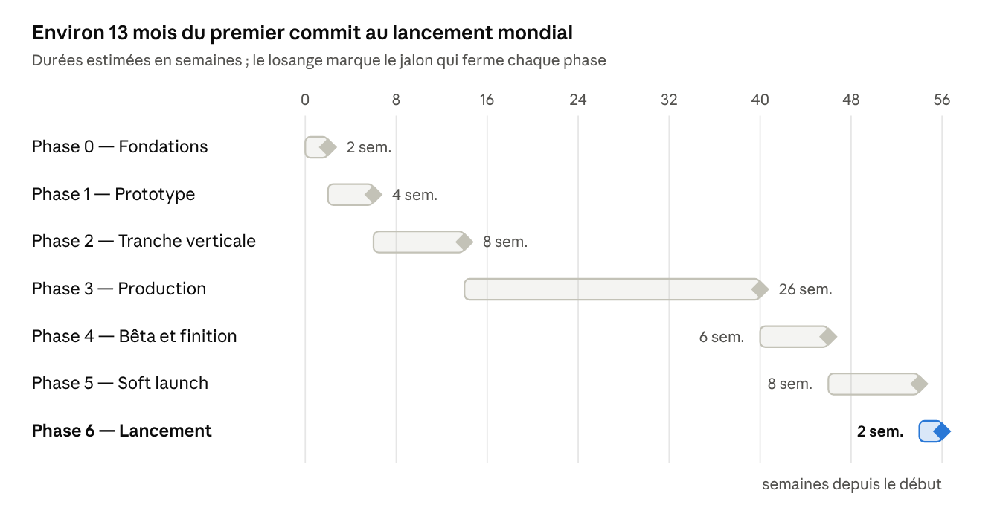

# Industrimental — Plan de développement

> Copie exportée du document vivant (Claude Docs) : https://claude.ai/artifact/3kYaVD4YnBafY64h1hp46t — la version de référence est le document en ligne.

Nov 6, 2026 · @Naomi

Industrimental passe du [GDD](https://claude.ai/artifact/F1vkuWbsfuwMhCVuMZG82a) au lancement mondial en 7 phases et environ 13 mois. Chaque phase se ferme sur un jalon vérifiable ; on ne passe pas à la suivante tant qu'il n'est pas atteint.

## Hypothèses et principes

- **Équipe** : 1 à 2 personnes, avec Claude pour le code, l'équilibrage et les textes, et ChatGPT pour les images. Aucune date imposée : les durées sont des estimations, pas des échéances.
- **Stack** : Go + Ebitengine, interface maison, coquilles natives Kotlin / Swift (section 14 du GDD).
- **Simulation d'abord** : l'économie est écrite et équilibrée en Go pur, sans écran, avant d'investir dans l'art. Une ère doit être amusante en placeholders avant d'être belle.
- **Contenu en données** : ères, stations, recettes, arbres et quêtes vivent dans des fichiers JSON. Ajouter une ère ne demande pas de code nouveau, sauf mécanique spéciale.
- **Un build jouable chaque semaine**, sur un vrai téléphone Android, à partir de la phase 1.
- **Coût matériel minimal** : pas de serveur en v1 ; frais fixes limités aux comptes développeur (Apple 99 $ US/an, Google 25 $ US une fois) et à l'abonnement ChatGPT.

## Feuille de route

La production des ères 3 à 10 occupe près de la moitié du calendrier ; tout ce qui la précède sert à la rendre répétable.

## Phase 0 — Fondations (environ 2 semaines)

Objectif : prouver que la chaîne Go → Ebitengine → téléphone fonctionne avant d'écrire le jeu.

- [ ] Dépôt Go structuré (`cmd/`, `internal/`, `mobile/`), linter, tests, intégration continue (tests + build desktop à chaque push).
- [ ] Scène de test Ebitengine : un sprite en calques qui tourne et 500 particules.
- [ ] Build Android via `ebitenmobile bind` et une coquille Kotlin, installé sur un vrai téléphone.
- [ ] Build iOS (xcframework + coquille Swift) ; demande un Mac et un compte Apple.
- [ ] Schéma JSON du contenu (ère, station, variante, recette, nœud, quête) et validation au démarrage.
- [ ] Squelette de sauvegarde versionnée.

**Jalon :** la scène de test tourne à 60 fps sur un Android milieu de gamme et sur un iPhone, et l'intégration continue est verte.

## Phase 1 — Prototype (environ 4 semaines)

Objectif : une ère 1 amusante en placeholders, équilibrée par simulation.

- [ ] `internal/sim` : stock, stations, niveaux, recettes, goulets, tick à 10 Hz.
- [ ] Marché dynamique (formule du GDD), marchands PNJ, contrats.
- [ ] Arbre d'ère : tronc, 4 branches, chemins parallèles, ponts, Clés d'ère.
- [ ] Quêtes (production, contrat, narrative simple) et conditions de complétion.
- [ ] Gains hors-ligne calculés analytiquement.
- [ ] Données complètes de l'ère 1 : 10 stations, 30 variantes, recettes, arbre d'environ 50 nœuds, 25 quêtes.
- [ ] `cmd/balance` : simulateur sans écran avec une stratégie par fin, qui sort les courbes de progression.
- [ ] Interface de debug brute (desktop) pour jouer l'ère 1.
- [ ] Essai d'interface : la fiche de station et une liste défilante, faites avec `ebitenui` puis en kit maison, pour trancher.

**Jalon :** l'ère 1 se joue de bout en bout en placeholders ; le simulateur atteint chacune des 4 fins en 1 à 2 jours ; le choix du kit d'interface est fait.

## Phase 2 — Tranche verticale (environ 8 semaines)

Objectif : les ères 1 et 2 dans leur qualité finale, pour valider le jeu auprès de vrais joueurs.

- [ ] Kit d'interface : mise en page, boutons à appui long, listes à inertie, fiches coulissantes, onglets, canevas zoomable, texte FR/EN.
- [ ] Écran principal portrait : barre du haut, panorama, jauges de complétion, panneau à onglets.
- [ ] Rendu : parallaxe 4 plans, stations en calques, animation procédurale, particules, cycle jour/nuit (shader Kage).
- [ ] Bible de style et guide de génération ChatGPT ; art final de l'ère 1 (environ 130 images).
- [ ] Ère 2 : données, équilibrage et art.
- [ ] Héritage : portail, Brevets, Savoir-faire, premiers nœuds de l'arbre d'Atelier, régime de croisière, Comptoir temporel.
- [ ] Événements à choix.
- [ ] Sauvegarde automatique et écran « Pendant ton absence ».
- [ ] Tutoriel d'ouverture avec Bob.

**Jalon :** test fermé avec 10 à 20 joueurs sur Android ; au moins la moitié terminent l'ère 1 et veulent continuer ; 60 fps tenus sur milieu de gamme.

## Phase 3 — Production (environ 26 semaines)

Objectif : tout le contenu et tous les systèmes de la v1. Les ères sont produites par lots de deux, environ 3 semaines par ère, pendant que les systèmes avancent en parallèle.

| Lot | Ères | Semaines | Nouveautés mécaniques | Systèmes menés en parallèle |
| --- | --- | --- | --- | --- |
| A | 3 Guildes, 4 Comptoirs maritimes | 1 – 6 | Recettes à 2 intrants, sous-produits, lettres de change, première fin hybride | Archives (coût croissant par Brevet dans l'ère), fins hybrides, modules et doublons de stations |
| B | 5 Manufactures, 6 Vapeur | 7 – 12 | Chaînes à 3 étapes, énergie (vapeur) | Arbre d'Atelier complet, pubs récompensées, notifications locales |
| C | 7 Électricité, 8 Plastique & atome | 13 – 18 | Énergie transversale, bourse | Achats intégrés (Sans pub, Soutien, Étincelles), cosmétiques, économie des Étincelles |
| D | 9 Numérique, 10 Spatiale | 19 – 24 | Marchés algorithmiques, Ascenseur spatial, fin narrative (l'Archiviste) | Sauvegarde cloud iCloud / Play Games, code de transfert, mesures d'audience anonymes (opt-in) |
| — | Tampon | 25 – 26 | — | Localisation anglaise complète, accessibilité, qualité graphique automatique pour l'entrée de gamme |

- Les noms et textes de chaque lot se finalisent dans [Textes de travail](https://claude.ai/artifact/SrEyhPwfVWoBEWxoScEeiS) avant sa phase d'écriture.
- Fin de chaque lot : un build testé de bout en bout, de l'ère 1 à la dernière ajoutée, avec une partie accélérée par le simulateur.

**Jalon :** version alpha complète. Les 10 ères, leurs 40 fins et 8 fins hybrides sont jouables, et toutes les fonctions de la v1 sont en place.

## Phase 4 — Bêta et finition (environ 6 semaines)

- [ ] Bêta fermée (Google Play test interne, TestFlight) avec 50 à 100 joueurs.
- [ ] Passe d'équilibrage sur toutes les ères, à partir des données de la bêta et du simulateur.
- [ ] Performance : profilage sur 3 téléphones de référence (entrée, milieu et haut de gamme), mémoire, démarrage, taille de l'application.
- [ ] Correction des bugs bloquants et majeurs ; robustesse de la sauvegarde (coupure, horloge, migration).
- [ ] Fiches des stores (captures, vidéo, textes FR/EN), politique de confidentialité, classification d'âge.

**Jalon :** aucun bug bloquant connu, objectifs de performance tenus, fiches des stores prêtes.

## Phase 5 — Soft launch (environ 8 semaines)

- Ouverture au **Canada** d'abord, puis aux **États-Unis** 2 à 3 semaines plus tard, une fois les premiers correctifs sortis.
- Mise à jour toutes les 1 à 2 semaines selon les indicateurs (voir plus bas) : durée des ères, points de décrochage, générosité des Étincelles.

**Jalon :** les indicateurs de rétention atteignent leurs cibles deux semaines de suite.

## Phase 6 — Lancement mondial (environ 2 semaines)

- [ ] Ouverture dans tous les pays, iOS et Android.
- [ ] Demande de mise en avant auprès d'Apple et de Google (à envoyer 4 à 6 semaines avant).
- [ ] Communication : bande-annonce, communautés d'incrementals, presse spécialisée mobile.

**Après le lancement :** la saison 1 (ère 11, colonisation du système solaire) entre en production, avec le même pipeline que les ères de la v1.

## Pipeline de production d'une ère

Chaque ère suit le même cycle de 3 semaines ; pendant la phase 3, deux ères avancent en décalé (l'une en art pendant que l'autre est en données).

1. **Semaine 1 — Design et données** : stations, variantes, recettes, arbre et quêtes en JSON ; le simulateur vérifie que chaque fin prend environ une semaine de jeu régulier.
2. **Semaine 2 — Art** : prompts depuis la bible de style, génération d'environ 130 images, détourage, atlas, intégration des calques et des émetteurs de particules.
3. **Semaine 3 — Textes et intégration** : textes FR/EN depuis le document de textes, PNJ, événements, partie complète sur téléphone, ajustements.

### Définition de « terminé » pour une ère

- [ ] Les 4 fins (et la fin hybride à partir de l'ère 3) sont atteignables, vérifiées par le simulateur et par une partie réelle.
- [ ] Toutes les stations ont leurs variantes, leurs 3 paliers visuels et leurs animations.
- [ ] Toutes les quêtes, tous les textes et tous les PNJ existent en français et en anglais, au statut Validé.
- [ ] Brevets, Savoir-faire, ressources d'époque et régime de croisière fonctionnent pour cette ère.
- [ ] 60 fps sur le téléphone milieu de gamme de référence ; aucune régression sur les ères précédentes.

## Indicateurs à suivre

Les cibles sont des points de départ, à ajuster pendant la bêta et le soft launch.

| Indicateur | Cible | Quand |
| --- | --- | --- |
| Rétention J1 (joueurs revenus le lendemain) | 40 % | Soft launch |
| Rétention J7 | 15 % | Soft launch |
| Rétention J30 | 6 % | Soft launch |
| Joueurs qui terminent l'ère 1 | 50 % | Tranche verticale, puis toujours |
| Durée médiane de l'ère 1 | 1 à 2 jours | Prototype, puis toujours |
| Durée médiane des ères 2 à 10 | Environ 1 semaine | Production, puis toujours |
| Sessions sans plantage | 99,5 % | Bêta, puis toujours |
| Images par seconde sur milieu de gamme | 60 | Toutes les phases |
| Pubs récompensées vues par joueur et par jour | 2 à 4 | Soft launch |
| Joueurs payants | 1 à 2 % | Soft launch |

## Risques et parades

| Risque | Impact | Parade |
| --- | --- | --- |
| Le kit d'interface maison prend plus de 5 semaines | Retarde la tranche verticale | Essai décisif en phase 1 ; repli sur `ebitenui` ; limiter les composants à ceux de l'écran principal |
| Images ChatGPT incohérentes d'une génération à l'autre | Rendu disparate, retouches longues | Bible de style, image de référence jointe à chaque prompt, retouche par lots, marge de regénération |
| Équilibrer 10 ères et 40 fins | Ennui ou blocage du joueur | Simulateur dès la phase 1, contenu en données, réglages sans nouveau build quand c'est possible |
| Pubs et achats via gomobile plus compliqués que prévu | Retarde la monétisation | Essai technique dès le lot B ; passerelle native réduite à quelques fonctions simples |
| Build iOS impossible sans Mac | Pas de version iOS | Prévoir un Mac (même d'occasion) ou une machine macOS dans le cloud dès la phase 0 |
| Production des ères plus lente que 3 semaines | Glissement de plusieurs mois | Tampon de 2 semaines ; option de lancer avec 8 ères et livrer les 2 dernières en mise à jour |
| Refus d'un store (pubs, confidentialité, âge) | Lancement retardé | Lire les règles dès la phase 3, soumettre la bêta tôt pour révéler les problèmes |

## Prochaines actions

- [ ] Choisir les téléphones de test (un Android d'entrée de gamme, un milieu de gamme, un iPhone) et confirmer l'accès à un Mac.
- [ ] Ouvrir les comptes développeur Google Play et Apple.
- [ ] Écrire le guide de génération d'assets ChatGPT et la bible de style, puis tester 10 images de l'ère 1.
- [ ] Lancer la phase 0 dans le dépôt : structure Go, intégration continue, scène de test, premier build Android.
